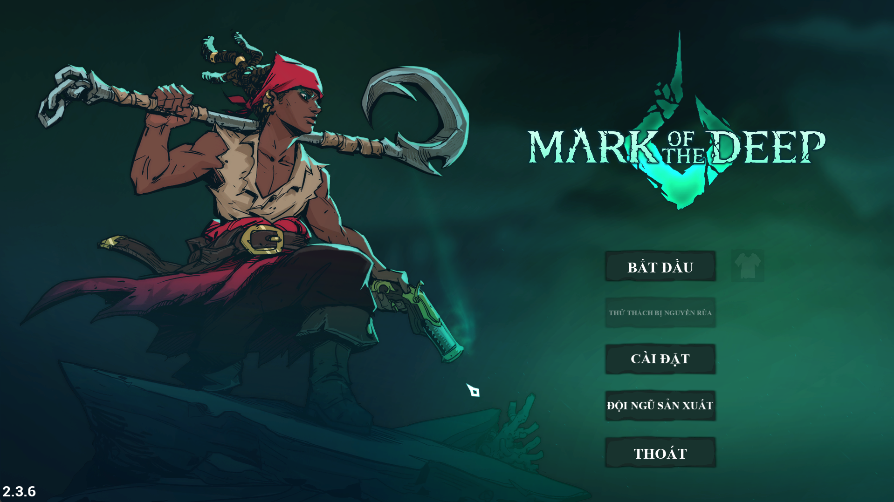
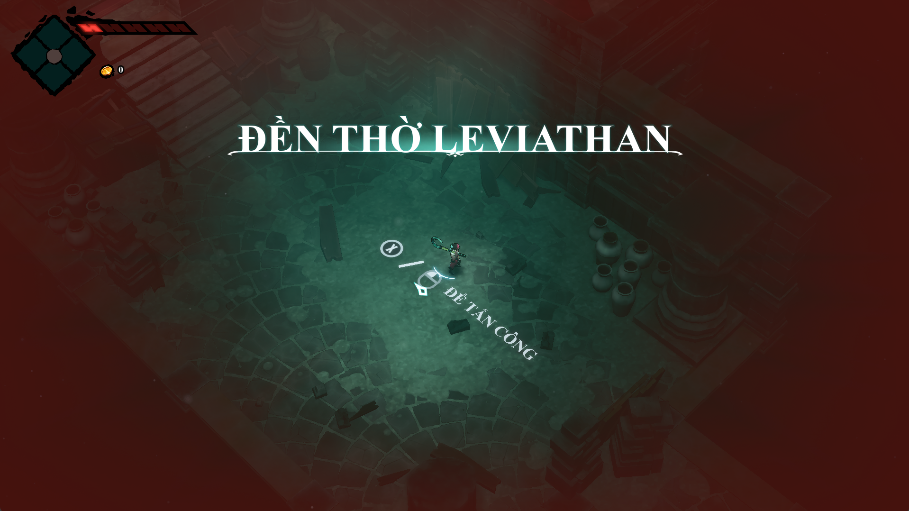

# Mark of the Deep Việt Hóa — Bản Dịch Tiếng Việt (Vietsub / Vietnamese Mod)

<p align="center">
  
  
  
  
  
</p>

Bản **Việt hóa Mark of the Deep** (Bản dịch Tiếng Việt / Vietsub / Vietnamese Localization) hoàn chỉnh 100% (2.946 chuỗi) kèm font tiếng Việt đầy đủ dành cho tựa game hành động phiêu lưu **Mark of the Deep (v2.3.6)** trên PC (Steam & Epic Games Store).

---

## Lưu ý về bản dịch

> [!NOTE]
> - **Bản dịch chia sẻ MIỄN PHÍ 100%** bởi **[Diiexe](https://github.com/diiexe)**. Nếu bạn phải trả tiền để mua hoặc tải bản Việt hóa này ở bất kỳ đâu thì **bạn đã bị lừa đảo**.
> - **Bản dịch này được dịch bằng AI**, mình làm chủ yếu để tự chơi cá nhân rồi tiện chia sẻ lại cho ai cần. Do không phải dịch thủ công trau chuốt từng chữ nên chắc chắn sẽ có chỗ chưa thật sự mượt, dùng được thì dùng, không dùng thì thôi nhé.
> - **Độ an toàn & Miễn trừ trách nhiệm:** Bản Việt hóa chỉ nạp file ngôn ngữ và phông chữ qua thư mục `~mods`, không ghi đè bất kỳ file gốc nào của game và mở 100% mã nguồn trên repo này. Tuy nhiên vì là bản mod cá nhân phi thương mại nên mình chỉ chia sẻ theo nguyên trạng, không hỗ trợ bảo hành và không chịu trách nhiệm nếu phát sinh lỗi game, xung đột bản cập nhật hay bất kỳ vấn đề nào liên quan đến tài khoản của bạn.
> - Toàn bộ dữ liệu văn bản gốc (`raw_text`) và bản dịch tiếng Việt (`translated_text`) được để mở hoàn toàn dạng `.json` trong thư mục `src/` để bất kỳ ai cần tra cứu, lấy dữ liệu hoặc tự chỉnh sửa câu từ đều dùng được ngay (hướng dẫn chi tiết bên dưới).

---

## Hình ảnh trong game

<p align="center">
  
</p>
<p align="center">
  
</p>

---

## Thông tin phiên bản & Khả năng tương thích

- **Phiên bản trò chơi hỗ trợ:** `v2.3.6` (Steam và Epic Games Store — Unreal Engine 5).
- **Cơ chế nạp:** Sử dụng file patch `pakchunk0-VietHoa_P.pak` nạp qua thư mục `~mods` của Unreal Engine 5. Hoàn toàn không sửa đổi hay ghi đè bất kỳ file gốc nào của game.

### Chú thích tương thích

- **Bản cũ hơn v2.3.6:** Cấu trúc bảng chuỗi khác biệt, cài vào có thể gây lệch câu thoại.
- **Bản mới hơn v2.3.6:** Nếu game cập nhật thêm nội dung mới, các chuỗi mới sẽ hiển thị tiếng Anh mặc định, các chuỗi cũ vẫn hiển thị tiếng Việt. Trường hợp game thay đổi cấu trúc bảng hash `.locres`, chỉ cần chạy script build lại mod từ dữ liệu nguồn.

---

## Hướng dẫn cài đặt & Gỡ bỏ (Dành cho người chơi)

### Cách 1: Cài đặt & Gỡ bỏ tự động bằng script (Khuyên dùng)
1. Tải gói **`MarkOfTheDeep_VietHoa_v1.0.0.zip`** từ trang **Releases** (hoặc trong thư mục `dist/`) và giải nén ra bất kỳ đâu.
2. Nhấp đúp chạy file **`CaiDat_VietHoa.bat`**.
3. Nhập **`1`** (Cài đặt bản Việt Hóa vào game):
   - Script sẽ tự động dò tìm thư mục cài đặt game trên máy (Epic Games / Steam). Nếu đúng thư mục, bạn chỉ cần nhấn **Enter**.
   - Nếu cài game ở vị trí khác, bạn chỉ cần copy đường dẫn thư mục game và dán trực tiếp vào cửa sổ rồi nhấn **Enter**.
4. Mở game và thưởng thức tiếng Việt!
5. **Khi muốn gỡ bỏ:** Chạy file **`GoCaiDat_VietHoa.bat`** (hoặc chạy **`CaiDat_VietHoa.bat`** và chọn **`2`**) rồi nhấn **Enter**. File mod sẽ được xóa sạch, đưa game về nguyên bản 100%.

### Cách 2: Cài đặt thủ công
1. Copy file **`pakchunk0-VietHoa_P.pak`** trong thư mục `dist/`.
2. Dán vào thư mục mod của game:
   ```text
   <Thư_Mục_Cài_Game>\MarkOfTheDeep\Content\Paks\~mods\
   ```
   *(Nếu chưa có thư mục `~mods`, hãy tự tạo thư mục này).*

---

## Dành cho người muốn lấy Raw Text / Tự sửa bản dịch & Đổi font chữ

Toàn bộ dữ liệu văn bản gốc của game và bản dịch đều được để ở định dạng JSON thuần túy (UTF-8), không nén kín, giúp bạn có thể xem trực tiếp trên trình duyệt GitHub hoặc tải cả kho chứa về bằng nút **`<> Code` -> `Download ZIP`**.

### 1. Giải thích các tệp trong `src/raw_text/` và `src/translated_text/`

| Đường dẫn tệp | Mô tả chi tiết |
| :--- | :--- |
| `src/raw_text/en_strings.json` | **Văn bản tiếng Anh gốc trích xuất 100% từ `MarkOfTheDeep.locres`**: Mảng JSON gồm **2.946 chuỗi** theo đúng thứ tự index (`0` -> `2945`) trong bảng chuỗi nhị phân của game. Ai cần lấy raw text tiếng Anh để nghiên cứu hoặc dịch lại từ đầu có thể dùng ngay file này. |
| `src/translated_text/vi_strings.json` | **Bản dịch Tiếng Việt hoàn chỉnh**: Mảng JSON gồm **2.946 chuỗi** ánh xạ 1-1 theo đúng số thứ tự dòng với `en_strings.json`. Khi muốn sửa bất kỳ câu dịch nào, chỉ cần mở file này bằng VS Code / Notepad++, bấm `Ctrl + F` tìm câu muốn sửa, lưu lại rồi chạy lệnh build bên dưới. |
| `src/tools/string_meta.json` | Bảng metadata `refcount` của 2.946 chuỗi trong `.locres` dùng để tái tạo chính xác cấu trúc nhị phân UE5. |
| `src/tools/templates/` | Chứa khung header nhị phân `.locres` và gói khung `.uasset` / `.uexp` của font chữ để biên dịch lại file `.pak` bất kỳ lúc nào mà không cần giải nén lại game gốc. |

> **Lưu ý khi tự sửa câu dịch:** Không xóa hoặc thêm dòng làm thay đổi tổng số 2.946 phần tử của mảng JSON, và giữ nguyên các biến kỹ thuật như `{0}`, `{CurrentGold}` cùng các thẻ định dạng `<Light>`, `<Emphasis>`, `</>`.

### 2. Đóng gói lại thành file mod (`.pak`) sau khi sửa text
Sau khi chỉnh sửa xong `src/translated_text/vi_strings.json`, mở terminal tại thư mục gốc của repo và chạy đúng 1 lệnh:
```bash
python src/tools/build_mod.py
```
Script sẽ tự động biên dịch lại `MarkOfTheDeep.locres` (chuẩn UTF-16LE của Unreal Engine 5), tích hợp bộ font Serif đầy đủ dấu tiếng Việt (`.ufont`), và đóng gói qua `repak.exe` thành file `dist/pakchunk0-VietHoa_P.pak` mới kèm mã kiểm tra `SHA256SUMS.txt`.

---

## Cấu trúc thư mục dự án

```text
Mark-of-the-Deep/
├── dist/                                   # Bộ cài đặt thành phẩm cho người chơi
│   ├── pakchunk0-VietHoa_P.pak             # File mod patch Unreal Engine 5 (3.09 MB)
│   ├── CaiDat_VietHoa.bat                  # Script cài đặt & gỡ bỏ (Menu 2 trong 1)
│   ├── GoCaiDat_VietHoa.bat                # Script gỡ cài đặt nhanh
│   ├── HuongDan_CaiDat.txt                 # Hướng dẫn ngắn gọn đi kèm bản nén
│   ├── MarkOfTheDeep_VietHoa_v1.0.0.zip    # Gói nén sẵn sàng phát hành
│   └── SHA256SUMS.txt
├── src/                                    # Mã nguồn mở & dữ liệu văn bản
│   ├── raw_text/
│   │   └── en_strings.json                 # 2.946 chuỗi tiếng Anh gốc (Raw Text)
│   ├── translated_text/
│   │   └── vi_strings.json                 # 2.946 chuỗi tiếng Việt (Ánh xạ 1-1)
│   └── tools/                              # Công cụ biên dịch .locres, .ufont & repak
│       ├── build_mod.py                    # Script build tổng hợp 1 chạm
│       ├── rebuild_locres.py               # Trình biên dịch UE5 Locres v3
│       ├── build_font_mod.py               # Trình đóng gói font Unicode .ufont
│       └── templates/                      # Khung header .locres & font descriptor
├── CHANGELOG.md
├── RELEASE_NOTES.md
└── README.md
```

---

## Tác giả & Bản quyền

- **Bản dịch Tiếng Việt & Bộ công cụ mã nguồn (`src/`, `dist/`):** Thực hiện và phát triển bởi **[Diiexe](https://github.com/diiexe)**. Chia sẻ công khai phi thương mại phục vụ cộng đồng; vui lòng ghi rõ nguồn `Diiexe (github.com/diiexe)` khi chia sẻ hoặc đăng tải lại.
- **Bản quyền trò chơi gốc:** Toàn bộ hình ảnh, âm thanh và tài sản trò chơi gốc thuộc về nhà phát triển **Mad Mimic**. Vui lòng mua game bản quyền trên Steam hoặc Epic Games Store để ủng hộ tác giả.
